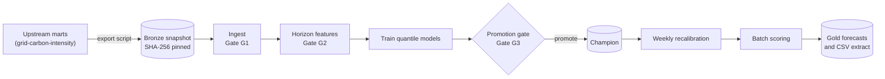

# Grid Carbon Intensity MLOps

Probabilistic 24-hour forecasts of grid carbon intensity for Germany-Luxembourg (`DE-LU`) and France
(`FR`): LightGBM quantile models with conformal calibration that is recomputed weekly, an MLflow
promotion gate, and Databricks Serverless jobs for training and batch scoring.

It extends the upstream repository `grid-carbon-intensity`, which answers *what was the carbon
intensity of each hour?* This one asks *what will it be over the next 1 to 24 hours, and how sure
can we be?*

> **Read this first**
>
> - **The repository is private and should stay private for now.** It contains an hourly dataset
>   derived from ENTSO-E data that is not on ENTSO-E's open-reuse list. See [Data and licence](#data-and-licence).
> - **All three pre-registered hypotheses were falsified.** That is the result, reported as it came out.
> - **The held-out test set was not kept fully blind.** See [What the results do and do not show](#what-the-results-do-and-do-not-show).
> - **Three planned parts are not built yet:** drift monitoring, the Tableau dashboard and the QA agent.

## Results at a glance

Evaluated once on a held-out period (13 September to 31 December 2025, 124,955 forecasts) under a
plan committed before the run. Full tables are in [docs/LOCKED_TEST_RESULTS.md](docs/LOCKED_TEST_RESULTS.md).

| | DE-LU | FR |
| :--- | :--- | :--- |
| Coverage of the 90% interval | 89.0% | 87.4% |
| 95% interval for that coverage | 85.5% to 92.2% | 83.9% to 90.3% |
| Inside the reference band (87% to 96%) | yes | yes, narrowly |
| Median beats "no change from now" in every horizon bucket | yes | yes |


The average hides three weaknesses:

- **FR under-covers at day-ahead lead times:** 86.3% at 13 to 24 hours, and its interval excludes 90%.
- **Calibration depends on the regime.** In DE-LU's highest renewable-share quartile coverage is
  83.3%. Those are the greenest hours, where a load-shifting user would act.
- **FR at one hour ahead does not beat persistence.**

### Hypotheses

| | Claim | Verdict |
| :--- | :--- | :--- |
| H1 | High-renewable hours in DE-LU have lower intensity and a wider interval | **Falsified.** Intensity is lower, but the interval is narrower, while the realized error is larger |
| H2 | On high solar and wind days, DE-LU is cleaner than FR at midday | **Falsified.** DE-LU was below FR on 0 of 53 qualifying days. Descriptive: the outcome was known in advance |
| H3 | Origin-state features dominate at short lead times and calendar features overtake them at day-ahead, with growing uncertainty | **Falsified.** Errors do grow with lead time, but origin-state features dominate at every lead time |

Each hypothesis was tested twice: as originally registered, and with a corrected method that respects
the autocorrelation of hourly data. The two agree in all three cases.

### What the results do and do not show

- **Not blind.** During a review on 15 November 2026 the held-out period was scored several times
  against an earlier model, and an early exploratory analysis included it. That review's result is
  what prompted the move to weekly recalibration. The current model's settings were then chosen on a
  separate validation period only. Details: [docs/ANALYSIS_PLAN_H1_H3.md](docs/ANALYSIS_PLAN_H1_H3.md), section 1.
- **One season.** About three and a half months of autumn and early winter, with no summer.
- **Forecast uncertainty only.** The interval assumes median emission factors. For FR, the
  uncertainty of the factors themselves is larger than the forecast interval.
- **Production-based intensity.** Cross-border flows are not accounted for.
- **Earlier figures are retired.** Coverage numbers of 91.63% and 89.26% reported before the review
  came from an uncommitted notebook and cannot be reproduced.

## How it works



- **Features.** For each zone, hour and lead time: the current intensity, its lags and trailing
  statistics, the current generation mix, and the calendar of the target hour. Nothing from after
  the forecast origin.
- **Model.** One LightGBM quantile model per zone and quantile (5%, 50%, 95%). It predicts the
  *change* from the current intensity, so "no change" is the starting point.
- **Calibration.** Split conformalized quantile regression, two-sided, with one pair of offsets per
  zone and lead time. The offsets are recomputed every 7 days from the trailing 30 days of realized
  errors, because the error distribution shifts with the season.
- **Splits.** Train 60%, calibration 15%, validation ("Gate-Val") 10%, held-out test 15%, in time
  order. A row belongs to a split only if its target hour does too, so no hour is shared.

## Quality gates

| Gate | What it enforces | Where |
| :--- | :--- | :--- |
| G1 Provenance | The snapshot's SHA-256 is pinned and checked on every load; each row traces to an upstream retrieval | `tests/test_ingestion_provenance.py` |
| G2 No temporal leakage | Every lag, rolling statistic, mix feature and target is re-derived by timestamp on each build and compared | `features/build_features.py`, `tests/test_no_leakage.py` |
| G3 Calibration and promotion | The gate re-scores challenger and champion itself. It requires coverage of 87% to 96% in every zone, a median that beats persistence in every zone and bucket, and a pinball loss no worse than the champion's | `models/evaluate_gate.py`, `tests/test_pyfunc_contract.py` |
| G4 Grounded QA agent | Not built yet | |

The tests are themselves tested. `scripts/mutation_audit.py` breaks one safeguard at a time in a
scratch copy and fails if the test suite does not notice.

## Quick start

Requires Python 3.11 or newer.

```bash
pip install -e ".[dev]"
```

| Task | Windows (PowerShell) | Linux or macOS |
| :--- | :--- | :--- |
| Lint and test | `.\scripts\dev.ps1 test` | `make test` |
| Run the pipeline locally | `.\scripts\dev.ps1 run-local` | `make run-local` |
| Run the breakage audit (several minutes) | `.\scripts\dev.ps1 audit` | `make audit` |

The local pipeline ingests the snapshot, builds features, trains, evaluates on Gate-Val and writes
`dashboards/data/latest_24h_forecasts.csv` and `docs/images/cqr_24h_fan_chart.png`. It takes about
13 seconds on mains power.

To check that the committed held-out results are reproduced exactly (about 8 minutes):

```bash
python notebooks/02_cqr_calibration_analysis.py --check
```

Do not use `--run`: the analysis plan allows one execution, and it has been used.

## Databricks

Two Serverless jobs are defined in `databricks.yml` and run from a wheel built from this repository.

| Job | Tasks |
| :--- | :--- |
| `carbon_training_pipeline` | ingest, features, train, gate |
| `carbon_batch_inference` | recalibrate the champion, then score with a Spark UDF |

```bash
databricks bundle deploy -t dev
databricks bundle run -t dev carbon_training_pipeline
databricks bundle run -t dev carbon_batch_inference
```

Both jobs were run end to end on a Databricks Free Edition workspace on 15 November 2026. The steps,
observed results, and what remains unverified are in
[docs/DATABRICKS_VERIFICATION.md](docs/DATABRICKS_VERIFICATION.md). The inference schedule is paused
on purpose: the snapshot is static, so a recurring run would rescore the same hours.

## Repository layout

| Path | Contents |
| :--- | :--- |
| `src/carbon_mlops/` | The package: `ingestion`, `features`, `models` (training, conformal calibration, gate), `inference`, `analysis`, `viz`, and `jobs.py` with one entry point per Databricks task |
| `tests/` | Unit and integration tests |
| `notebooks/` | Exploratory analysis and the held-out evaluation |
| `scripts/` | Task runner, snapshot export, breakage audit, results-document generator |
| `data/bronze_snapshot/` | The pinned hourly snapshot and its documentation |
| `dashboards/data/` | Forecast extract, calibration table, hypothesis results, run record |
| `docs/` | Concept note, plans, results, the review register |

## Reproducibility

- **Same platform: exact.** The held-out results reproduce bit for bit on the machine that produced
  them, and two runs on Databricks agree with each other to every digit.
- **Across platforms: close.** Gate-Val coverage is 89.5% and 89.0% (DE-LU, FR) on Windows on ARM
  and 89.4% and 88.8% on Databricks, from identical data. The cause is not verified. Expect
  differences of 0.1 to 0.2 percentage points, far smaller than the uncertainty intervals.
- **The snapshot can be rebuilt** from the upstream marts with `scripts/export_bronze_snapshot.py`,
  given access to them.

## Not built yet

| Planned | Status |
| :--- | :--- |
| Drift and coverage monitoring (`monitoring/compute_drift.py`) | Not started |
| Tableau dashboard | Not started; its input files exist in `dashboards/data/` |
| Grounded QA agent (`agent/`) and gate G4 | Not started |
| Day-ahead prices, load and flows as features | Deferred; the snapshot does not export them |

Open limitations and every issue found in review are tracked in
[docs/REVIEW_ISSUES.md](docs/REVIEW_ISSUES.md).

## Data and licence

The snapshot in `data/bronze_snapshot/` is derived from ENTSO-E Transparency Platform data
(generation per production type), processed by the upstream repository with life-cycle emission
factors from IPCC AR5 and Itten et al. (2023). Source: ENTSO-E Transparency Platform.

**That data is not on ENTSO-E's list of data available for reuse.** The upstream repository
therefore does not redistribute it, and records that publishing results derived from it awaits the
agreement of the data owners (RTE and the German transmission system operators). This repository
commits an hourly aggregate of the same data, ships it inside the wheel, and writes forecasts based
on it. Until the owners' position is known:

- keep this repository private;
- do not publish the snapshot, the extracts in `dashboards/data/`, or a public dashboard built on them.

This is a statement of the situation as documented upstream, not legal advice.

No licence file has been added to this repository yet.

## Documentation

| Document | Purpose |
| :--- | :--- |
| [docs/CONCEPT_NOTE.md](docs/CONCEPT_NOTE.md) | Motivation, design, hypotheses as registered |
| [docs/IMPLEMENTATION_GUIDE.md](docs/IMPLEMENTATION_GUIDE.md) | Sprint plan |
| [docs/ANALYSIS_PLAN_H1_H3.md](docs/ANALYSIS_PLAN_H1_H3.md) | The plan committed before the held-out evaluation |
| [docs/LOCKED_TEST_RESULTS.md](docs/LOCKED_TEST_RESULTS.md) | Full results and interpretation |
| [docs/DATABRICKS_VERIFICATION.md](docs/DATABRICKS_VERIFICATION.md) | What was run on Databricks and what was observed |
| [docs/REVIEW_ISSUES.md](docs/REVIEW_ISSUES.md) | Every issue from the pre-freeze review and its status |
| [data/bronze_snapshot/README.md](data/bronze_snapshot/README.md) | How the snapshot is built, its columns and known gaps |

## Author

Dr. Adewole Olagoke. Capstone project, GreenBootcamps, December 2026.
