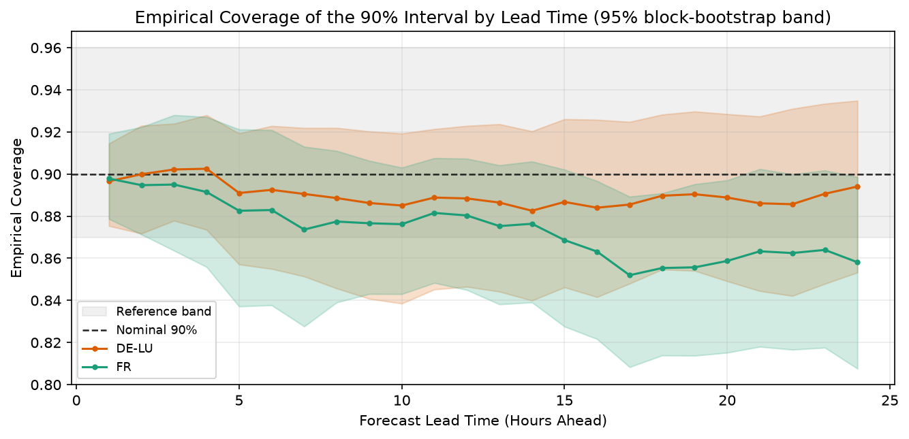
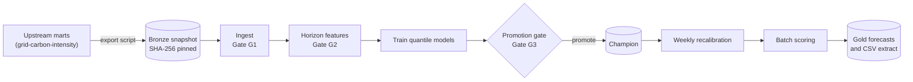

# Grid Carbon Intensity MLOps

Probabilistic 24-hour forecasts of grid carbon intensity for Germany-Luxembourg (`DE-LU`) and France
(`FR`): LightGBM quantile models with conformal calibration that is recomputed weekly, an MLflow
promotion gate, and Databricks Serverless jobs for training and batch scoring.

It extends the upstream repository `grid-carbon-intensity`, which answers *what was the carbon
intensity of each hour?* This one asks *what will it be over the next 1 to 24 hours, and how sure
can we be?*

> **Read this first**
>
> - **Source of the data: ENTSO-E Transparency Platform; data: 50Hertz, Amprion, TenneT, TransnetBW
>   (DE-LU) and RTE (FR).** It is used on the owners' terms, which require the source to be named.
>   See [Data and licence](#data-and-licence).
> - **All three pre-registered hypotheses were falsified.** That is the result, reported as it came out.
> - **The held-out test set was not kept fully blind.** See [What the results do and do not show](#what-the-results-do-and-do-not-show).
> - **Not finished:** the two dashboards are not built (their data and build notes exist). The QA agent
>   is built and tested, and has been run with four hosted models and traced to the workspace, but
>   only from a laptop: it has not been run inside Databricks against the live tables.

## Results at a glance

Evaluated once on a held-out period (13 September to 31 December 2025, 124,955 forecasts) under a
plan committed before the run. Full tables are in [docs/LOCKED_TEST_RESULTS.md](docs/LOCKED_TEST_RESULTS.md).

| | DE-LU | FR |
| :--- | :--- | :--- |
| Coverage of the 90% interval | 89.0% | 87.4% |
| 95% interval for that coverage | 85.5% to 92.2% | 83.9% to 90.3% |
| Inside the reference band (87% to 96%) | yes | yes, narrowly |
| Median beats "no change from now" in every horizon bucket | yes | yes |



The average hides three weaknesses:

- **FR under-covers at day-ahead lead times:** 86.3% at 13 to 24 hours, and its interval excludes 90%.
- **Calibration depends on the regime.** In DE-LU's highest renewable-share quartile coverage is
  83.3%. Those are the greenest hours, where a load-shifting user would act.
- **FR at one hour ahead does not beat persistence.**

### Does acting on the forecast help?

Each day, pick one window for a flexible load from the forecast issued at 00:00 UTC, and compare what
that window actually emitted with the day's average. Held-out period, 103 days per zone:

| Zone | Window | Chosen from the median forecast | "Repeat yesterday's cleanest hours" | Best possible in hindsight |
| :--- | :--- | :--- | :--- | :--- |
| DE-LU | 3 h | 18.9% cleaner | 12.9% cleaner | 25.4% cleaner |
| FR | 3 h | 14.2% cleaner | 9.5% cleaner | 18.7% cleaner |

The forecast beats the rule of thumb and captures about three quarters of what hindsight would
allow. In summer (the validation period) the rule of thumb does almost as well in DE-LU, because
the solar-driven daily pattern repeats.

The same result in the units a decision needs. Intensity in gCO2eq/kWh is the same number as kg per
MWh, so the difference between the day's average and the chosen window is the CO2 avoided per MWh
moved into that window:

| Zone | Strategy | Avoided per MWh moved | Days the choice was dirtier than the day's average | Worst day |
| :--- | :--- | :--- | :--- | :--- |
| DE-LU | Forecast (median) | 66.2 kg | 6.8% | 21.7% dirtier |
| DE-LU | Repeat yesterday | 46.6 kg | 22.3% | 66.2% dirtier |
| FR | Forecast (median) | 5.2 kg | 9.7% | 14.8% dirtier |
| FR | Repeat yesterday | 3.4 kg | 15.5% | 29.5% dirtier |

A load of 1 MWh a day would have avoided about 6.8 t CO2 over the 103 days in DE-LU and about 0.5 t
in FR, where the grid is already so clean that timing matters little. The forecast's stronger
argument is reliability: in DE-LU it backfires on a third as many days as the rule of thumb, and its
worst day is a third as bad.

Three limits. Choosing by the upper bound (the "cautious" strategy) did not help: in DE-LU it avoided
less (63.5 kg) and backfired more often (12.6% of days) than choosing by the median, so on this
evidence the interval informs how far to trust a forecast, not which window to pick. The figures
cover September to December 2025 and are not scaled to a year. Nothing is said in euros: the project
has no price data. All window lengths and both periods are in
`dashboards/data/window_strategy_summary.csv`; weekly figures are in `window_value_weekly.csv`.

### Hypotheses

| | Claim | Verdict |
| :--- | :--- | :--- |
| H1 | High-renewable hours in DE-LU have lower intensity and a wider interval | **Falsified.** Intensity is lower, but the interval is narrower, while the realized error is larger |
| H2 | On high solar and wind days, DE-LU is cleaner than FR at midday | **Falsified.** DE-LU was below FR on 0 of 53 qualifying days. Descriptive: the outcome was known in advance |
| H3 | Origin-state features dominate at short lead times and calendar features overtake them at day-ahead, with growing uncertainty | **Falsified.** Errors do grow with lead time, but origin-state features dominate at every lead time |

Each hypothesis was tested twice: as originally registered, and with a corrected method that respects
the autocorrelation of hourly data. The two agree in all three cases.

### What the results do and do not show

- **Not blind.** During a review on 15 November 2026 the held-out period was scored several times
  against an earlier model, and an early exploratory analysis included it. That review's result is
  what prompted the move to weekly recalibration. The current model's settings were then chosen on a
  separate validation period only. Details: [docs/ANALYSIS_PLAN_H1_H3.md](docs/ANALYSIS_PLAN_H1_H3.md), section 1.
- **One season.** About three and a half months of autumn and early winter, with no summer.
- **Forecast uncertainty only.** The interval assumes median emission factors. For FR, the
  uncertainty of the factors themselves is larger than the forecast interval.
- **Production-based intensity.** Cross-border flows are not accounted for.
- **Earlier figures are retired.** Coverage numbers of 91.63% and 89.26% reported before the review
  came from an uncommitted notebook and cannot be reproduced.

## How it works



- **Features.** For each zone, hour and lead time: the current intensity, its lags and trailing
  statistics, the current generation mix, and the calendar of the target hour. Nothing from after
  the forecast origin.
- **Model.** One LightGBM quantile model per zone and quantile (5%, 50%, 95%). It predicts the
  *change* from the current intensity, so "no change" is the starting point.
- **Calibration.** Split conformalized quantile regression, two-sided, with one pair of offsets per
  zone and lead time. The offsets are recomputed every 7 days from the trailing 30 days of realized
  errors, because the error distribution shifts with the season.
- **Splits.** Train 60%, calibration 15%, validation ("Gate-Val") 10%, held-out test 15%, in time
  order. A row belongs to a split only if its target hour does too, so no hour is shared.

## Quality gates

| Gate | What it enforces | Where |
| :--- | :--- | :--- |
| G1 Provenance | The snapshot's SHA-256 is pinned and checked on every load; each row traces to an upstream retrieval | `tests/test_ingestion_provenance.py` |
| G2 No temporal leakage | Every lag, rolling statistic, mix feature and target is re-derived by timestamp on each build and compared | `features/build_features.py`, `tests/test_no_leakage.py` |
| G3 Calibration and promotion | The gate re-scores challenger and champion itself. It requires coverage of 87% to 96% in every zone, a median that beats persistence in every zone and bucket, and a pinball loss no worse than the champion's | `models/evaluate_gate.py`, `tests/test_pyfunc_contract.py` |
| G4 Grounded QA agent | Every number in an answer is a fact returned by a tested tool. A check re-reads each finished answer and refuses it if it contains any other number. A language model, when used, may only choose the tool and its arguments | `agent/tools.py`, `agent/qa_agent.py`, `tests/test_agent_tools.py` |

### Asking the agent

The agent answers three kinds of question from the forecast and monitoring tables: when the cleanest
hours are in a zone, how the two grids compare, and whether the model is still healthy.

```
> python -m carbon_mlops.agent.qa_agent "What is the cleanest 4-hour window in Germany?"
In Germany-Luxembourg (DE-LU), the cleanest 4-hour window by the median forecast runs from 12 Sep 2025 10:00 to 12 Sep 2025 14:00 UTC, in the forecast issued 12 Sep 2025 09:00 UTC. Expected carbon intensity in that window is 120 g CO2 per kWh (90% interval: 96 to 149), against 207 on average over the 24 forecast hours. That is 42% lower, or 87 kg CO2 avoided per MWh moved into the window. This is what the forecast expects, not a measured saving.
```

That answer is computed from the committed forecast snapshot, which is a past forecast, not a live
one. A question outside the three kinds gets a refusal that contains no figures. The agent never
does arithmetic and a language model never writes the answer: by default a keyword router picks the
tool, and with `--router llm` a model picks it instead, falling back to keywords if its reply is not
a valid tool call.

The tests are themselves tested. `scripts/mutation_audit.py` breaks one safeguard at a time in a
scratch copy and fails if the test suite does not notice.

## Quick start

Requires Python 3.11 or newer.

```bash
pip install -e ".[dev]"
```

| Task | Windows (PowerShell) | Linux or macOS |
| :--- | :--- | :--- |
| Lint and test | `.\scripts\dev.ps1 test` | `make test` |
| Run the pipeline locally | `.\scripts\dev.ps1 run-local` | `make run-local` |
| Compute drift and coverage monitoring | `.\scripts\dev.ps1 monitor` | `make monitor` |
| Write the dashboard extracts | `.\scripts\dev.ps1 dashboards` | `make dashboards` |
| Run the breakage audit (several minutes) | `.\scripts\dev.ps1 audit` | `make audit` |
| Ask the QA agent a question | `python -m carbon_mlops.agent.qa_agent "..."` | the same |
| Recompute the numbers behind the presentation's charts | `.\scripts\dev.ps1 slides-data` | `make slides-data` |

The local pipeline ingests the snapshot, builds features, trains, evaluates on Gate-Val and writes
`dashboards/data/latest_24h_forecasts.csv` and `docs/images/cqr_24h_fan_chart.png`. It takes about
13 seconds on mains power.

To check that the committed held-out results are reproduced exactly (about 8 minutes):

```bash
python notebooks/02_cqr_calibration_analysis.py --check
```

Do not use `--run`: the analysis plan allows one execution, and it has been used.

## Databricks

Two Serverless jobs are defined in `databricks.yml` and run from a wheel built from this repository.

| Job | Tasks |
| :--- | :--- |
| `carbon_training_pipeline` | ingest, features, train, gate |
| `carbon_batch_inference` | recalibrate the champion, then score with a Spark UDF, compute monitoring and write the dashboard extracts |

```bash
databricks bundle deploy -t dev
databricks bundle run -t dev carbon_training_pipeline
databricks bundle run -t dev carbon_batch_inference
```

Both jobs were run end to end on a Databricks Free Edition workspace on 15 November 2026, before the
monitoring and dashboard-extract tasks were added; those two ran successfully on 17 November 2026. The model fitted on Databricks is not numerically identical to the local one (its median forecasts differ by about 2% in DE-LU), and every figure in this README comes from the local model. The steps,
observed results, and what remains unverified are in
[docs/DATABRICKS_VERIFICATION.md](docs/DATABRICKS_VERIFICATION.md). The inference schedule is paused
on purpose: the snapshot is static, so a recurring run would rescore the same hours.

## Repository layout

| Path | Contents |
| :--- | :--- |
| `src/carbon_mlops/` | The package: `ingestion`, `features`, `models` (training, conformal calibration, gate), `inference`, `analysis`, `viz`, and `jobs.py` with one entry point per Databricks task |
| `tests/` | Unit and integration tests |
| `notebooks/` | Exploratory analysis and the held-out evaluation |
| `scripts/` | Task runner, snapshot export, breakage audit, results-document generator |
| `data/bronze_snapshot/` | The pinned hourly snapshot and its documentation |
| `dashboards/data/` | Forecast extract, calibration table, hypothesis results, run record |
| `dashboards/slides/` | The numbers behind the presentation's charts and the code that draws them ([notes](dashboards/slides/README.md)) |
| `docs/` | Concept note, plans, results, the review register |

## Monitoring

`monitoring/compute_drift.py` writes `dashboards/data/gold_monitoring.csv`, one row per weekly
monitoring date, zone and metric, from July to December 2025:

- **Rolling 7-day coverage** per zone and per horizon bucket, with the share of misses on each side,
  the mean interval width, and the median's skill against "no change from now".
- **Feature drift** as a population stability index over the trailing 30 days, against the whole
  training period and against the same 30 days one year earlier.

How to read it:

- **Weekly coverage is noisy.** A week holds a few thousand strongly correlated forecasts, so single
  weeks outside the 87% to 96% band are expected. A run of them is the signal.
- **The drift thresholds (0.10 and 0.25) are conventions for independent samples.** A month of
  hourly grid data is far from independent, so the index is high much of the time. Compare zones and
  features with each other; do not read a single "alert" as proof of a structural change.
- **Skill against persistence falls from summer to winter.** With one year of data this cannot be
  separated into season (persistence is a weak baseline when solar drives a daily cycle) and model
  age (the base models are fitted once and only their calibration is refreshed).

The monitor replays the forecasts the weekly recalibration would have issued. It tunes nothing and
changes no model.

## Reproducibility

- **Same platform: exact.** The held-out results reproduce bit for bit on the machine that produced
  them, and two runs on Databricks agree with each other to every digit.
- **Across platforms: close.** Gate-Val coverage is 89.5% and 89.0% (DE-LU, FR) on Windows on ARM
  and 89.4% and 88.8% on Databricks, from identical data. The cause is not verified. Expect
  differences of 0.1 to 0.2 percentage points, far smaller than the uncertainty intervals.
- **The snapshot can be rebuilt** from the upstream marts with `scripts/export_bronze_snapshot.py`,
  given access to them.

## Not built yet

| Planned | Status |
| :--- | :--- |
| One Tableau and one Power BI dashboard | Not built. Their data files and per-visual build notes are in [dashboards/README.md](dashboards/README.md) |
| The QA agent running inside Databricks | The agent and gate G4 are built and tested. Run from a laptop, the model router answered 18 of 18 evaluation questions on each of four Databricks hosted models, and three questions were traced to an MLflow experiment on the workspace and read back. It has not been run as a workspace job or notebook, so it has only ever read the committed snapshots, not the live Gold tables |
| Day-ahead prices, load and flows as features | Deferred; the snapshot does not export them |

Open limitations and every issue found in review are tracked in
[docs/REVIEW_ISSUES.md](docs/REVIEW_ISSUES.md).

## Data and licence

**Source: ENTSO-E Transparency Platform; data: 50Hertz, Amprion, TenneT, TransnetBW (DE-LU) and RTE (FR).**

The data is the actual generation per production type (ENTSO-E document A75) for the bidding zones
DE-LU and FR, 2024 to 2025. The upstream repository `grid-carbon-intensity` turns it into carbon
intensity with life-cycle emission factors from IPCC AR5 WG3 Annex III and Itten et al. (2023). The
snapshot in `data/bronze_snapshot/` is an hourly aggregate of that result.

**The carbon-intensity values, forecasts and all other figures here are the author's own
computations.** They are not published, checked or endorsed by ENTSO-E, the transmission system
operators or RTE.

This data is not on ENTSO-E's list of data available for reuse, so its use rests on the terms of the
primary data owners:

| Data | Owner | Terms |
| :--- | :--- | :--- |
| DE-LU generation (A75) | 50Hertz, Amprion, TenneT, TransnetBW | Use granted on 5 November 2026 under ENTSO-E's open-data licence, on the condition that the source is named (netztransparenz.de reference NTZ-CDVDPM8I). The source wording used above was confirmed the same day (reference NTZ-OI0Z6IUU) |
| FR generation (A75) | RTE | Answer of 12 November 2026, referring to RTE's legal notices: reuse is permitted subject to the source being mentioned; changing or distorting the content is prohibited; the user alone is responsible for the use made of the data |

No day-ahead price data and no load data is used or stored in this repository. RTE's answer names
JAO as the owner of the day-ahead prices; that question concerns the upstream repository only.

Anyone reusing the snapshot or the extracts in `dashboards/data/` must name the source as above and
is bound by the same terms. This is a statement of the situation as the author has documented it,
not legal advice.

**The code is MIT-licensed** (see [LICENSE](LICENSE)): use it, change it, ship it, and keep the notice.
That licence covers the code and documentation only. It does not and cannot cover the data in
`data/bronze_snapshot/` and `dashboards/data/`, whose reuse is governed by the owners' terms above.

## Documentation

| Document | Purpose |
| :--- | :--- |
| [docs/CONCEPT_NOTE.md](docs/CONCEPT_NOTE.md) | Motivation, design, hypotheses as registered |
| [docs/IMPLEMENTATION_GUIDE.md](docs/IMPLEMENTATION_GUIDE.md) | Sprint plan |
| [docs/ANALYSIS_PLAN_H1_H3.md](docs/ANALYSIS_PLAN_H1_H3.md) | The plan committed before the held-out evaluation |
| [docs/LOCKED_TEST_RESULTS.md](docs/LOCKED_TEST_RESULTS.md) | Full results and interpretation |
| [docs/DATABRICKS_VERIFICATION.md](docs/DATABRICKS_VERIFICATION.md) | What was run on Databricks and what was observed |
| [docs/REVIEW_ISSUES.md](docs/REVIEW_ISSUES.md) | Every issue from the pre-freeze review and its status |
| [data/bronze_snapshot/README.md](data/bronze_snapshot/README.md) | How the snapshot is built, its columns and known gaps |

## Author

Dr. Adewole Olagoke.
